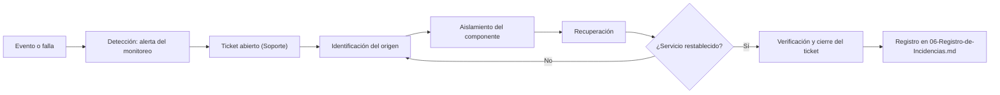

# 03. Monitoreo y FCAPS

| Sección | Responsable | Estado |
|---|---|---|
| F. Gestión de fallas | Jefe de proyecto | Borrador |
| C. Gestión de configuración | Admin. de infraestructura | Borrador |
| A. Gestión de consumo | Admin. de monitoreo | Pendiente |
| P. Gestión de desempeño | Especialista en seguridad | Pendiente |
| S. Gestión de seguridad | Especialista en soporte | Pendiente |
| NOC y alertas | Admin. de monitoreo | Pendiente |

---

## F. Gestión de fallas

**Responsable:** Jefe de proyecto. **Plataforma:** PNETLab.
**Estado:** borrador (los campos `[por definir]` se llenan con los demás roles).

### F.1 Objetivo

Detectar fallas, identificar su origen, aislar el componente afectado, aplicar una solución,
registrar el incidente y documentar el tiempo de recuperación, de forma integrada con las
demás funciones de FCAPS.

### F.2 Definiciones

| Término | Significado en este proyecto |
|---|---|
| Evento | Cualquier cambio de estado registrado por un equipo o por el monitoreo. |
| Alerta | Evento que el monitoreo marca como relevante y notifica. |
| Falla | Componente o servicio que no está disponible (no responde). |
| Degradación | Componente o servicio disponible pero fuera de umbral (latencia, pérdida, utilización). Los umbrales los define Seguridad (P): `[por definir]`. |
| Incidente | Falla o degradación que afecta el servicio y se atiende con ticket. |
| Recuperación | Servicio restablecido y verificado con las mismas pruebas de referencia. |

### F.3 Ciclo de gestión de fallas

| Paso | Qué se hace | Quién | Evidencia |
|---|---|---|---|
| 1. Detectar | El monitoreo genera la alerta o un usuario reporta el problema. | Monitoreo (A) | Captura de la alerta |
| 2. Abrir ticket | Se registra el incidente con prioridad y descripción. | Soporte (S) | Ticket |
| 3. Identificar el origen | Se diagnostica por capas (enlace, red, servicio) con las pruebas de referencia. | Jefe (F) con Infra (C) | Capturas del diagnóstico |
| 4. Aislar | Se separa el componente afectado para limitar el impacto. | Infra (C) | Captura del estado |
| 5. Recuperar | Se aplica la solución o se restaura desde el respaldo. | Infra (C) | Capturas antes y después |
| 6. Registrar y cerrar | Se verifica, se cierra el ticket y se llena el registro de incidencias. | Soporte (S) y Jefe (F) | Entrada en el archivo 06 |

### F.4 Tiempos que se miden

Todos los equipos deben tener la hora sincronizada por NTP antes de medir. De lo contrario
los tiempos no son comparables.

| Marca | Momento |
|---|---|
| T0 | Inicio de la falla (cuando se provoca o se produce) |
| T1 | Detección (primera alerta o aviso) |
| T2 | Origen identificado |
| T3 | Componente aislado |
| T4 | Servicio recuperado y verificado |
| T5 | Ticket cerrado |

| Métrica | Fórmula |
|---|---|
| Tiempo de detección | T1 − T0 |
| Tiempo de diagnóstico | T2 − T1 |
| Tiempo de aislamiento | T3 − T2 |
| **Tiempo de recuperación** | **T4 − T0** |
| Tiempo de resolución del ticket | T5 − apertura del ticket |

### F.5 Severidad (provisional)

> Se confirma con Soporte (S) y Seguridad (P). Los tiempos objetivo quedan en el SLA
> ([05-SLA-y-Mesa-de-Ayuda.md](05-SLA-y-Mesa-de-Ayuda.md)).

| Prioridad | Criterio | Tiempo de respuesta | Tiempo de resolución |
|---|---|---|---|
| P1 Crítica | Sin salida a Internet o caída de varios servicios | [por definir] | [por definir] |
| P2 Alta | Degradación para varios clientes o pérdida de redundancia | [por definir] | [por definir] |
| P3 Media | Afecta a un cliente o a un servicio no crítico | [por definir] | [por definir] |
| P4 Baja | Consulta o solicitud sin afectación | [por definir] | [por definir] |

### F.6 Catálogo de casos de falla

| ID | Caso | Componente | Qué se provoca | Detección esperada | Recuperación esperada | Sev. prov. | FCAPS |
|---|---|---|---|---|---|---|---|
| F-01 | Falla de un enlace interno | Enlace NUC-01 ↔ DIST-01 | Bajar la interfaz del enlace | Alerta de interfaz caída; cambio de topología RSTP | Reconvergencia por el camino alterno vía DIST-02 | P3 | F, C, P |
| F-02 | Falla de un proveedor de balanceo | Enlace FW-01 ↔ ISP1 (o ISP2) | Bajar el enlace WAN | Alerta de gateway caído | Todo el tráfico sale por el otro ISP; se mide la pérdida de capacidad | P2 | F, A, P |
| F-03 | Falla de ambos proveedores principales (failover) | ISP1 e ISP2 | Apagar ambos enlaces | Alerta de ambos gateways; activación de ISP3 | Salida por ISP3 y regreso al restablecer; se mide la conmutación | P2 (P1 si ISP3 también cae) | F, C, A, P |
| F-04 | Falla de un dispositivo de distribución | DIST-01 o DIST-02 (confirmar con Infra) | Apagar el switch | Alerta de host caído y servicios sin respuesta | Reinicio o restauración desde respaldo; se verifican los servicios | P1 | F, C, P |
| F-05 | Falla del proxy transparente | PROXY-01 | Apagar el equipo o detener el servicio | Alerta de host o servicio caído | Retirarlo del camino (puenteo) o restablecerlo | P1 | F, C |
| F-06 | Pérdida de conectividad de un cliente | CLI-0X / ACC-0X | Bajar el puerto de acceso del cliente | Alerta de puerto o host del cliente caído | Restablecer el puerto; verificar DHCP y salida a Internet | P3 | F, C |
| F-07 | Degradación de un servicio | Enlace de salida / media server | Saturar con tráfico (streaming o iperf) | Alerta por umbral de utilización o latencia | Aplicar control de ancho de banda y verificar KPI | P2 | F, A, P, C |
| F-08 | Caída de un servicio | SRV-STO o SRV-MEDIA | Detener el servicio (equipo encendido) | Alerta de servicio o puerto caído | Reiniciar el servicio o restaurar su configuración | P3 | F, C |

**Cobertura de los casos mínimos del enunciado**

| Caso mínimo | Cubierto por |
|---|---|
| Falla de un enlace | F-01, F-02 |
| Pérdida de conectividad de un cliente | F-06 |
| Falla de un dispositivo | F-04, F-05 |
| Degradación de un servicio | F-07 |
| Falla de un proveedor y failover | F-02, F-03 |

### F.7 Roles durante un caso

| Rol | Qué hace |
|---|---|
| Jefe (F) | Dirige el caso, cronometra T0 a T5 y coordina el diagnóstico |
| Infra (C) | Provoca la falla, aísla y recupera |
| Monitoreo (A) | Confirma la alerta y el tiempo de detección |
| Seguridad (P) | Compara los tiempos con los umbrales |
| Soporte (S) | Abre, actualiza y cierra el ticket |
| Analista | Guarda capturas, tiempos y evidencias |

### F.8 Riesgos y decisiones pendientes

- **Proxy como punto único de falla:** F-05 prueba el retiro del proxy del camino.
- **Hora sincronizada:** el NTP debe estar activo en todos los equipos antes de la fase 3.
- **Umbrales de degradación:** los define Seguridad (P).
- **Alertas por caso:** se acuerdan con Monitoreo (A) en la fase 0 y se validan en la fase 2.

### F.9 Evidencias a recolectar

- [ ] Diagrama del ciclo de gestión de fallas (`evidencias/diagramas/`)
- [ ] Catálogo de casos revisado por Infra, Monitoreo y Soporte
- [ ] Severidades confirmadas con Soporte y Seguridad
- [ ] Una ficha de incidente por cada caso F-01 a F-08 (en la fase 3, en el archivo 06)
- [ ] Tabla resumen de tiempos de detección y recuperación por caso